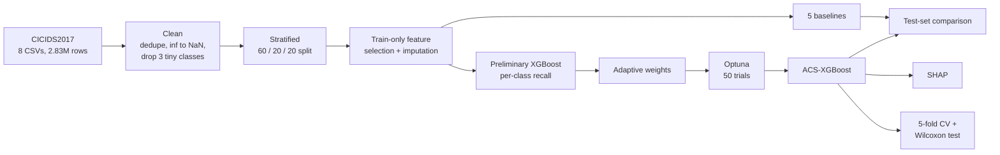

# Adaptive Cost-Sensitive XGBoost for Network Intrusion Detection

Multi-class intrusion detection on **CICIDS2017** with a focus on the part that usually goes wrong: the rare
attacks. Over 80% of the traffic is benign and some attack types make up well under 1% of the data, so
accuracy is ~99.9% for almost any model. This project looks at **macro F1** instead and tests an automatic
way of weighting classes (**ACS-XGBoost**) against LightGBM and four XGBoost baselines.


**Everything is in one notebook:** [`notebooks/acs_xgboost_cicids2017.ipynb`](notebooks/acs_xgboost_cicids2017.ipynb)
(outputs and plots are saved in it, so it renders directly on GitHub).

---

## The idea

Hand-picked class weights ("XSS x5, Bot x3") are guesses that need redoing whenever the data changes. ACS-XGBoost
builds each class weight from two measurable things:

- **How rare the class is:** $W_f(c) = \dfrac{N}{K \cdot N_c}$
- **How hard it is for a first-pass model:** $W_d(c) = 2 - \text{Recall}(c)$

Both are min-max normalised, blended with $\alpha = 0.5$, rescaled to mean 1 and clipped to $[0.5, 10]$. The
difficulty term is measured on an inner split of the *training* data only, so validation and test rows never
influence the weights.


## Pipeline



## Data

| | |
|---|---|
| Raw rows | 2,830,743 (8 CSVs) |
| After removing duplicates and 3 tiny classes | 2,522,294 |
| Classes | 12 (BENIGN + 11 attack types) |
| Features after train-only selection | 48 (of 78) |
| Split (train / val / test) | 1,513,376 / 504,459 / 504,459, stratified |

Heartbleed, SQL Injection and Infiltration (11, 21 and 36 samples) were dropped. Zero-variance and
highly-correlated (|r| > 0.95) columns are chosen from the training split only and median imputation uses
training medians, so nothing from validation or test leaks into preprocessing.


## Results (held-out test set, 504,459 flows)

| Model | Accuracy | Balanced Acc. | **Macro F1** | MCC | Train time |
|---|---:|---:|---:|---:|---:|
| XGBoost V4 (hand-tuned weights) | 99.865 | 93.64 | **91.63** | 0.9955 | 83 s |
| **ACS-XGBoost** (adaptive weights + Optuna) | 99.870 | 93.34 | **91.51** | 0.9957 | 52 s |
| XGBoost V3 (hand-tuned weights) | 99.859 | 93.42 | 91.20 | 0.9953 | 60 s |
| XGBoost V1 (balanced weights) | 99.862 | 93.02 | 91.07 | 0.9954 | 60 s |
| XGBoost V2 (SMOTE) | 99.819 | 93.83 | 90.50 | 0.9940 | 477 s |
| LightGBM (`is_unbalance`) | 99.716 | 89.31 | 86.13 | 0.9906 | 116 s |

F1 on the three hardest classes:

| Model | Bot | Web Attack Brute Force | Web Attack XSS |
|---|---:|---:|---:|
| LightGBM | 0.673 | 0.595 | 0.287 |
| XGBoost V1 | 0.805 | 0.729 | 0.431 |
| XGBoost V2 (SMOTE) | 0.662 | 0.747 | 0.488 |
| XGBoost V3 | 0.800 | 0.720 | 0.461 |
| XGBoost V4 | 0.813 | 0.735 | 0.482 |
| **ACS-XGBoost** | **0.823** | 0.671 | **0.521** |


### Robustness (5-fold CV on train + val, 2.0M rows)

| | Macro F1 (mean ± std) |
|---|---|
| ACS-XGBoost | 0.9118 ± 0.0053 |
| Plain XGBoost, same hyperparameters, no weights | ≈ 0.9146 |

One-sided Wilcoxon signed-rank test (ACS > baseline): **p = 0.906**.


## What I take from this

- **Weighting matters more than model choice.** Every weighted XGBoost variant beats LightGBM by roughly 4 to 5.5
  macro-F1 points, while accuracy hardly moves.
- **ACS-XGBoost gets competitive weights without manual tuning.** It lands within about 0.1 macro-F1 points of the
  best hand-tuned baseline and has the best F1 on Bot and XSS.
- **It is not shown to beat plain XGBoost.** In cross-validation the unweighted baseline is on par (slightly
  higher on average) and the paired test finds no significant difference. With only five folds the test has little
  power, so this reads as "no measurable difference", not as proof of equivalence either.
- **The gain on XSS costs Brute Force.** The two web-attack classes are mostly confused with each other, which
  points to a feature problem rather than a weighting problem.
- **SMOTE was the most expensive option (about 8x training time) and did not pay off.**

### SHAP

`Destination Port` dominates (mean |SHAP| 0.85 vs 0.39 for the next feature). That fits service-specific attacks,
but it is also a warning that the model could be leaning on dataset-specific patterns.


## Limitations

- Eight of the twelve classes sit on the 0.5 weight floor after clipping, so the weights separate "the hardest rare
  classes" from the rest more than they rank all twelve.
- The Optuna search used the validation split, which is also part of the CV data, so CV scores are slightly
  optimistic for both models. The Optuna sampler was not seeded; the best parameters are saved but a re-run of the
  search can give a different set.
- Everything uses a single dataset and a random split. A time-based split or a second dataset would be the real
  test of generalisation.
- The Wilcoxon test has only five paired observations (smallest possible one-sided p is about 0.031).

## Repo layout

```
.
├── notebooks/
│   └── acs_xgboost_cicids2017.ipynb   # full pipeline with saved outputs
├── assets/                            # figures used in this README
├── requirements.txt
└── README.md
```

## Run it

The notebook was run on a Kaggle GPU notebook (Tesla P100, XGBoost 3.2, LightGBM 4.6, scikit-learn 1.6). The
dataset is downloaded with `kagglehub`, so a Kaggle account/API token is needed outside Kaggle.

```bash
pip install -r requirements.txt
jupyter lab notebooks/acs_xgboost_cicids2017.ipynb
```

It falls back to CPU if no GPU is found, but the Optuna search and SMOTE model will be slow. Models, tables and
plots are written to `final_model/` (git-ignored).

## Dataset

Sharafaldin, Lashkari, Ghorbani. *Toward Generating a New Intrusion Detection Dataset and Intrusion Traffic
Characterization*, ICISSP 2018. Canadian Institute for Cybersecurity, University of New Brunswick.

## Author

Hana Mariyam Musthafa, MCA, Manipal Institute of Technology.
